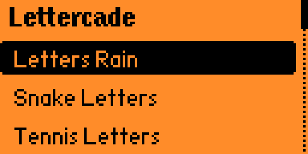
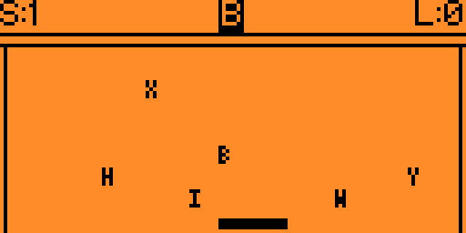
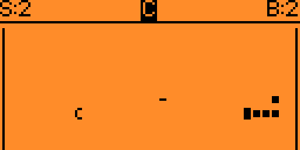

  

# Lettercade (ASCII Arcade) for Flipper Zero

Lettercade is a collection of three quick, letter-themed arcade games for Flipper Zero: **Letters Rain**, **Snake Letters**, and **Tennis Letters**. Each game uses a compact ASCII-inspired playfield and has its own settings and saved scores.

## Build
Copy this folder to `applications_user/lettercade` (firmware tree) or run `ufbt` inside it, then
`ufbt launch`. The built app is `lettercade.fap` (Apps > Games > Lettercade).
Every push is also built by GitHub Actions; download `lettercade.fap` from the run's artifacts.

To test builds, download the `lettercade.fap` artifact from the Actions run and copy it to `SD Card/apps/Games/` with qFlipper’s file manager, [Flipper Lab](https://lab.flipper.net/archive) or by mounting the SD card. It then appears under Apps → Games.

## Games

### Letters Rain

Move the paddle to catch the target letter shown at the top of the screen. In **Alphabet** mode, catch the letters from A to Z in order. In **Words** mode, catch each highlighted letter in the displayed word to complete it; each completed word adds to your score. Miss a target and the run ends. Catching a different letter shrinks the paddle, while `+` and `-` change its size and `*` restores its starting size. The letters fall faster as you progress.

### Snake Letters

Steer the snake with the D-pad and collect the target shown in the HUD. **Alphabet** mode follows A to Z; in **Words** mode, a letter is blanked out in a displayed word and you must collect that letter. Each target makes the snake longer and increases your score. Avoid your own body, distraction letters, and any enabled walls. When a wall is disabled, the snake wraps around that edge. Temporary `-` and `/` tokens shorten the snake.

### Tennis Letters

Keep the bouncing letter ball in play by moving the paddle underneath it. Each successful return adds to your score, and the ball cycles through the alphabet. A missed return ends the game; the ball speeds up as the rally continues. **Easy** keeps the bounce angle steady, while **Hard** lets the landing position and paddle movement affect the angle.

## Controls

- **Letters Rain / Tennis Letters:** Left/Right moves the paddle; hold to keep moving.
- **Snake Letters:** Use the D-pad to steer.
- **OK:** Pause or resume; after a game ends, start another round of the same mode.
- **Back:** Pause during a game; from the pause or results screen, return to that game's menu.

## Settings

Settings are saved on the device. Each game's menu has its own options:

- **Letters Rain:** fall speed, starting paddle size, and number of decoy letters.
- **Snake Letters:** snake speed, number of distractions, and side and top/bottom walls.
- **Tennis Letters:** paddle size and ball speed.
- **App:** sound on/off and reset to defaults. Resetting settings keeps saved scores.

## Screenshots

| Main menu | Letters Rain | Tennis Letters |
| --- | --- | --- |
|  |  |  |

## Custom words
Create `SD Card/apps_data/lettercade/words.txt` to customize the words used in the Words modes. Use up to 24 words, each 2-15 letters long, separated by spaces, commas, or new lines. Only letters A-Z are used. If the file is missing or contains no valid words, Lettercade uses: BOX, CAT, DOG, CACTUS, and RAINBOW.

## Files
`lettercade.c`, `application.fam`, `lettercade_10px.png` (app icon), `images/cover.png`
(128x64 splash cover shown in the app), `screenshots/` (8x preview of the cover for this README).

## License

MIT — do whatever you like with it.
