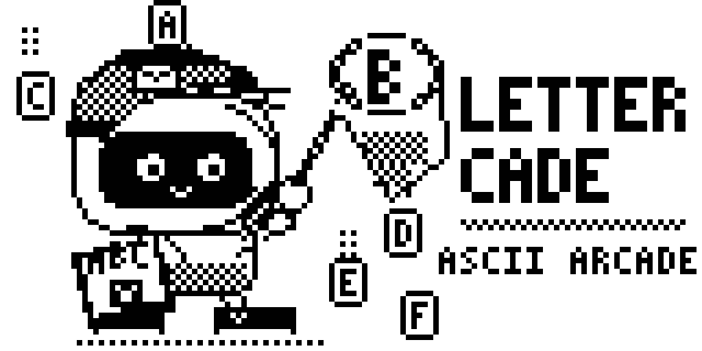

  

# Lettercade (ASCII Arcade) for Flipper Zero

Three letter games ported from the ESP32 clock: **Letters Rain**, **Snake Letters**, **Tennis Letters**.

## Build
Copy this folder to `applications_user/lettercade` (firmware tree) or run `ufbt` inside it, then
`ufbt launch`. The built app is `lettercade.fap` (Apps > Games > Lettercade).
Every push is also built by GitHub Actions; download `lettercade.fap` from the run's artifacts.

## Controls
- Rain / Tennis: Left/Right move the paddle (hold to keep moving)
- Snake: D-pad steers
- OK = pause / resume / play again, Back = pause, then menu

## Settings (saved on the device)
- Letters Rain: fall speed, starting paddle size, decoy letters
- Snake Letters: speed, distractions, side walls, top/bottom walls
- Tennis Letters: paddle size, ball speed
- App: sound on/off, Reset to defaults (scores are kept)

## Custom words
`SD Card/apps_data/lettercade/words.txt`: words (a-z, 2-15 letters, up to 24) separated by spaces,
commas or new lines. Used by the Words modes. Defaults: box, cat, dog, cactus, rainbow.

## Files
`lettercade.c`, `application.fam`, `lettercade_10px.png` (app icon), `images/cover.png`
(128x64 splash cover shown in the app), `screenshots/` (8x preview of the cover for this README).

## License

MIT — do whatever you like with it.
